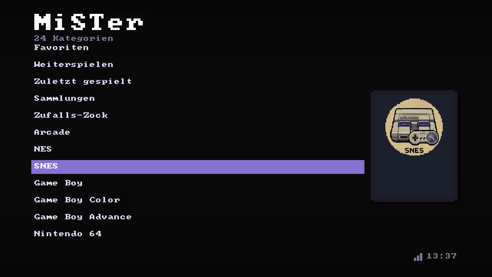
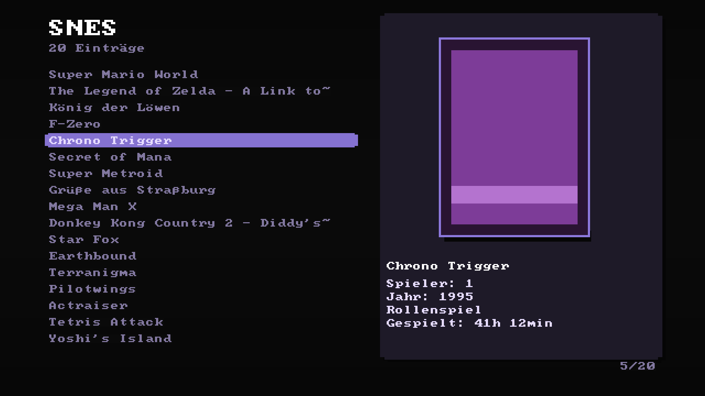
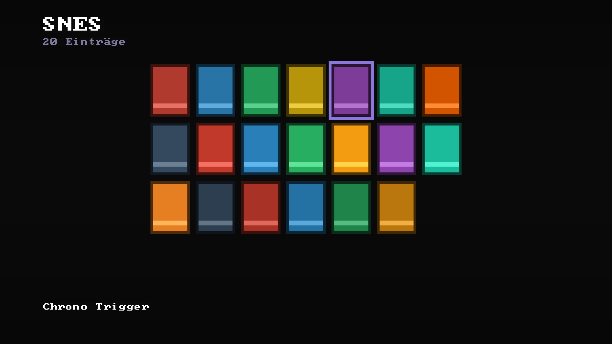
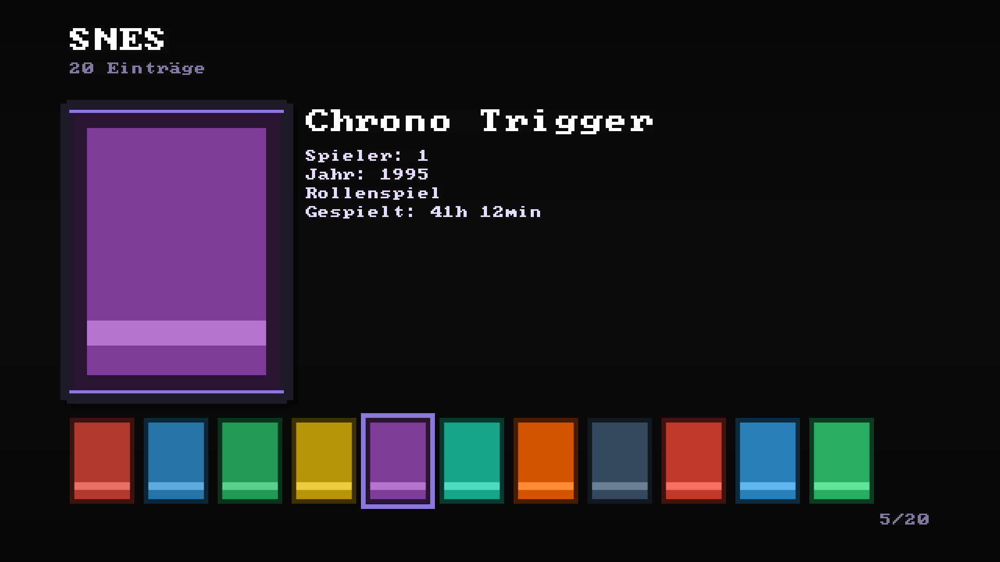
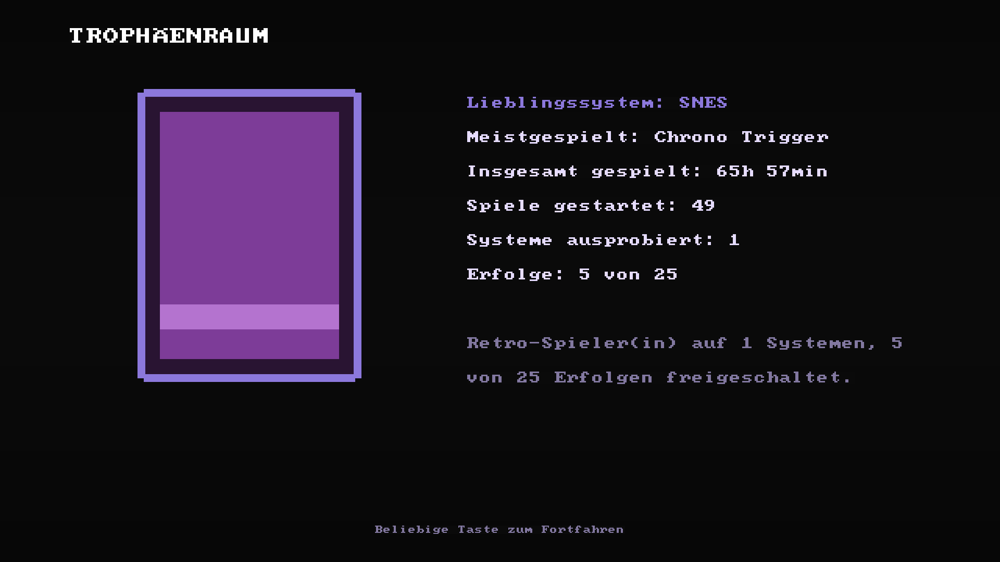
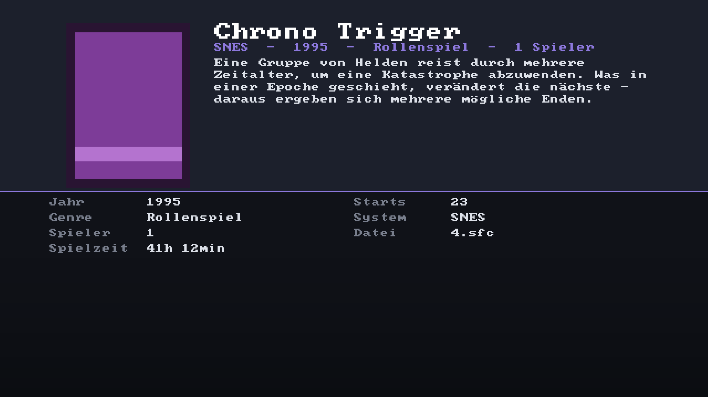

# Dragend — MiSTer Custom Frontend v5.1

**By Dragrem2K**, with contributions from **TheRealSuTefan** and **Dfense**.

🇩🇪 [Deutsch](README.md) · 📖 [Manual](docs/MANUAL_EN.md) ·
📄 [Manual as PDF](docs/Dragend_Manual_EN.pdf) ·
🔰 [For beginners (PDF)](docs/Dragend_Beginners_EN.pdf) ·
📝 [Changelog](CHANGELOG_EN.md)

A game browser for the MiSTer FPGA: cover art, game info, gamepad and
keyboard control, background music, CRT and HDMI treated as equals.
Plain standard Python — not a single extra dependency on the MiSTer.

<p align="center">
  
  &nbsp;&nbsp;
  
</p>
<p align="center">
  
  &nbsp;
  
  &nbsp;
  
  &nbsp;
  
</p>
<p align="center"><sub>List, grid, gallery, trophy room — and a game’s info page. Every image rendered straight from the program code (<code>tools/screenshots_bauen.py</code>); cover art and save data are placeholders.</sub></p>

---

## New in v5.1

Twenty builds since v5.0 (319-338). The essentials in six lines -
everything else is in the [changelog](CHANGELOG_EN.md):

- **Computers with games:** C64 (One-Load), Amiga (AmigaVision and ADF
  disks), Amstrad CPC and DOS (0MHz) as categories of their own with a
  console photo and badge - plus a **computer check** that tells you
  what is missing.
- **Back from a game by pad:** Start+Select+L+R on a Nintendo pad, even
  while MiSTer locks the controller. Plus a **controller test** that
  shows every button you press.
- **Fast and calm:** start in **1.9 seconds** with 41,397 games (bench
  24), page turns without a full-screen redraw, no pad stall in the
  first seconds, and a first start on a fresh card that you can see.
- **Scroll speed up to 4x** - at 3x and 4x a held step jumps several
  rows.
- **An attract mode you can use:** only games with a cover, OK starts
  the game shown, left/right switches the system. Plus a **boot logo to
  choose** and **RetroAchievements awards** right in the list.
- **Box art download without a third-party mirror:** whatever Update
  All has already delivered is detected and not downloaded again. New:
  a **beginner's guide** as a PDF
  ([English](docs/Dragend_Beginners_EN.pdf),
  [German](docs/Dragend_Einsteiger.pdf)).

## New in v5.0

Forty-four builds since v4.9 (275-318). The essentials in six lines -
everything else is in the [changelog](CHANGELOG_EN.md):

- **The main page has six views** instead of three: list, grid and
  gallery are joined by **tile wall**, **dashboard** and **carousel**
  (HDMI only). Plus **20 cut-out console photos** as the category
  picture - categories without a photo keep their badge.
- **The game list has four:** the **coverflow** now sits alongside the
  classic gallery as an equal - the selected cover large in the
  centre, its neighbours smaller beside it.
- **A game's info page** (context menu -> *Info*): cover, data,
  playtime and description on one screen.
- **Core management:** an overview of every installed core with its
  age, a core version **per game**, and a choice between the standard,
  the RetroAchievements and the **netplay** core at launch.
- **Held keys no longer pile up:** ten presses become one jump. A
  change of direction used to take up to 424 ms, now 81 ms - measured
  on the device (bench, section M).
- **The bench presses the keys itself.** Section M feeds real key
  presses through the real input path instead of setting the index and
  drawing - so what it measures is what happens when you press.

## Install: one file, one click

1. Download
   [`Frontend_Install.sh`](https://raw.githubusercontent.com/dragrem2k-coder/mister-frontend/main/Scripts/Frontend_Install.sh)
   (right-click → *Save link as*).
2. Copy it to `/media/fat/Scripts/` — over WinSCP, or with the SD card in
   your PC.
3. On the MiSTer: run **Scripts → "Frontend Install"**.

The script fetches everything else itself, sets up autostart and
launches the frontend when it is done. No SSH, no unpacking.

**Updating:** run the same script again. Your cover art, music and
settings are left untouched.

**Uninstalling:** `Frontend_Uninstall.sh` — your MiSTer is exactly as it
was. Nothing in the system is modified, no kernel, no image.

No internet on the MiSTer, or prefer SSH or a manual install? See
[Installation & Update (PDF, English)](docs/Installation_and_Update_EN.pdf).

---

## Features

### Your collection

| | |
|---|---|
| **Three views** | List, grid, gallery — for the game list *and* the main page, switchable per category (F10 / Select+Y) |
| **List polish** | Scroll speed as a number (0.5x to 2x, never faster than your device can draw), folders before or after the games, favourites first, game count on folders (“Hacks [412]”) |
| **Large grid tiles** | Ten tiles of 270×361 instead of twenty-one of 176×235. Back to the small grid with `touch /media/fat/frontend/raster_klein` |
| **Cover art & game info** | Your own set under `art/`, plus the database under `/media/fat/docs` if you have it. A download script is included |
| **Game descriptions** | Shown next to the cover in gallery view |
| **Filters** | By genre, year, player count and developer (Tab / Select+L2+R2), remembered per category — under an automatic or **your own name** |
| **Arrange the home page** | Decide the order and visibility of the categories yourself. “System” always stays, last |
| **Search** | Type to narrow the list instantly |
| **Context menu** | **F1**, or **X** on the pad, shows what is possible right here — favourite, completed, hide, search, filter, jump to letter, view, random. All of it existed already, just spread over seven different keys |
| **Button legend** | Bottom right, next to the clock and network symbol: “A:Open  B:Back  X:Menu  Y:Music”. Main page, HDMI, and it yields to any message |
| **Hide entries** | Take single games, whole folders or a category out of the display. Nothing on the card is touched, and an overview brings it all back |
| **List cleanup** | Boot files, beta/proto/hack tags and duplicate regions drop out during the scan — the best region wins. Plus an optional “only games with a database match” |
| **`gamelist.xml`** | If you curated your ROM folder with Skraper, the file is read: year, genre, players, publisher, description, cover. No setting needed, and your own data always wins |
| **Favourites & collections** | Your own lists across all systems — **including the favourites you marked in the MiSTer OSD** (one list, two sources; nothing is written to your favourites file) |
| **Recently played** | Its own category, sorted by last launch |
| **ZIP archives** | ROMs inside archives are found and launched without ever extracting anything |
| **Single-game folders** | Dissolved automatically — matters for PSX, Mega CD and Saturn, where each game sits in its own folder |
| **Multi-disc games** | “Game (Disc 1/2/3)” becomes **one** entry; on launch the frontend asks which disc. Only with at least two parts in the same folder under the same remaining name — two versions stay two entries |
| **Game manuals** | If a manual (PDF, text, Markdown) sits under `/media/fat/docs/<core>/`, the context menu offers **Show manual** — displayed with MiSTer's own viewer. The entry only appears when there really is one |
| **ROMs on NAS/USB** | Network shares and USB numbers above 5 are discovered dynamically |
| **NFC tags** | Zaparoo is detected and launched; the frontend tells you the command for the tag. Nothing is written into Zaparoo's folder |
| **Storage watch** | Plugged a stick in? The frontend says so — and on request reads back **only what changed** instead of everything |
| **ROM watch** | Add or remove a ROM while it runs — over WinSCP or MiSTer Companion — and the frontend says so, then re-reads **only the affected system** on request. It never re-reads on its own |

### Personal

| | |
|---|---|
| **Trophy room** | A profile screen: most-played game, favourite system, achievement count |
| **Year in review** | Statistics for the current calendar year |
| **Playtime tracker** | How long, how often, when last — per game and per system |
| **Top 10 lists** | By playtime, launch count, systems |
| **Your own ratings** | Like an old games magazine: fun in percent, plus graphics, sound/music and controls depending on the device if you like, a "Dragend hit" stamp from 85%. A short question after playing (A saves, B later), verdict, second opinion, "then and now", a test archive per system, a **monthly issue** and CSV export. **Can be switched off — and starts off after an update** |
| **RetroAchievements** | Progress, achievement showcase (F6), popup when you earn one |
| **Completed & custom achievements** | Also for games RA does not support |
| **Easter eggs & frontend level** | Hidden achievements, anniversary notes, seasonal decorations |
| **Zufalls-Zock (random pick)** | Draws random games you have not played yet |
| **The draw, with sound** | Titles spin like a wheel while a draw sound plays — duration 1–5 s, adjustable or off |

### Display & sound

| | |
|---|---|
| **CRT (15 kHz) and HDMI** | Each with its own look and layout, not one as a side effect of the other |
| **Portrait (TATE)** | Its own layout for rotated screens — the tile size is computed, not hard-coded |
| **Theme editor** | Change and save colours while running, no hand-edited file |
| **Themes** | Colour schemes, accent colour, adjustable screen margin |
| **System art box** | The category menu shows the highlighted system's logo on the right — all 48 are included |
| **Attract mode** | Screensaver showing cover art, delay from 30 s to 15 min |
| **Boot animation** | Your own video, or the built-in D-pad animation |
| **Music** | Your MP3s or Rainwave internet radio (five stations), one shared volume control |
| **Navigation sounds** | Generated tones, can be switched off |
| **MiSTer's own fonts** | The `.pf` character sets in `/media/fat/font` are read and used — the same typeface as the OSD |
| **Shadow masks** | MiSTer's own `.png` masks as a grid over the picture, four strengths |
| **Background images** | Your own images behind the list, dimmed and cropped; several are cycled |
| **Fine details** | Scrollbar on the right, accent bar per row, hairline to the cover column, accent rule above the list — one switch for all of it, cost measured (+0.04 ms per scroll step) |
| **CRT test pattern** | For setting geometry and sharpness |

### Technical & control

| | |
|---|---|
| **Language** | German / English, switchable at any time |
| **Custom key mapping** | Keyboard and gamepad freely assignable |
| **Autostart** | On/off from the menu |
| **Stream overlay for OBS** | Shows game, cover and music track in a browser source; every row can be switched off individually, the game title included. The **achievement popup** shows new RA achievements at once — with a queue, counting points and a corner of its own. Plus the **achievement wall**: every achievement of the running game as a grid, the tile you just unlocked flashes, and it can scroll through a fixed window. Next to it you can place the **running game's cover** — top, bottom, left or right |
| **Screen mirror** | On CRT? `:8080/mirror` shows the frontend screen in a browser — phone, second monitor, stream. The running game comes from the FPGA and is not part of it |
| **Clock** | MiSTer has no battery clock; the frontend fetches the time over SNTP, and you set the time zone once in half-hour steps |
| **Prepare thumbnails** | Pre-compute covers once so nothing loads in later |
| **PC tool** | The same work on a Windows PC instead of the MiSTer — hours become minutes (`pc_tools/`) |
| **C module** | `libdragend.so` scales images about 100× faster. Optional; without it Python does the work |
| **Picture guard** | Brings the picture back when MiSTer re-initialises the framebuffer and the Linux console shows through (kernel 6.18) |
| **JPEG thumbnails** | Large thumbnails are stored compactly — folders open noticeably faster |
| **Scan protection** | Symlink loops and excessive nesting are detected instead of followed forever |
| **`update_all` from the menu** | Launches the existing script; the label names the last run (“23 days ago”) |
| **Core browser** | Pick the core build per system, with a warning when `update_all` has deleted the chosen file |
| **Core updates: what’s new** | After an `update_all` run: which cores are new, changed or gone. Its log is **not** parsed — what is compared is the state of the core folders before and after, which is correct whatever version of `update_all` you have |
| **Report on itself** | `--show` writes down what is installed, how it is configured and how fast it runs — as a file in `/tmp` — and then runs the presentation |
| **Presentation** | System → Info → Presentation (or `--demo`): Dragend in six chapters — presentation pages and the **real screens**: collection, every colour scheme as a mini interface, settings in six groups, the speed of each view **measured on the device**, your numbers. Right/A next, left/B back, hold B to end |
| **Package check** | A half-applied update ends in an instruction, not a crash |

All of it in detail: **[Manual](docs/MANUAL_EN.md)**.

---

## Controls, briefly

| Key | Pad | |
|---|---|---|
| Arrow keys | D-pad | Navigate |
| **F1** | **X** | **Context menu** — what is possible right here |
| Enter | A / Start | Select, enter folder |
| Esc | B / Select | Back |
| F2 or `/` | Select + A | Search |
| Tab | Select + L2/R2 | Filter |
| F6 | Select + X | Achievement showcase |
| F7 / F8 | L2 / R2 | Mark completed / favourite |
| F10 | Select + Y | Switch view |
| F11 | — | Launch a random game |
| F12 | Guide / Mode | Open the MiSTer OSD |
| **F1** *(in a game)* | **X** | Back to the frontend. Esc does the same but must be held for ~0.6 s |

**F9 is deliberately left free.** MiSTer uses it itself to switch
between console and graphics mode — the frontend even injects it. The
key-mapping wizard rejects it for that reason.

The full mapping is in the
[manual PDF](docs/Dragend_Manual_EN.pdf).

---

## MiSTer Linux from 2026-09-07 (kernel 6.18) — works as of build 169

The MiSTer Linux update of **7 September 2026** moves the kernel from
5.15.1 to 6.18.x and changed framebuffer access along the way. The
MiSTer forum puts it plainly: *"Front Ends have to be patched due to
framebuffer changes"* — **Degauss**, the **Zaparoo Frontend** and
**Console Mode** all had to follow.

You can recognise it by this line in `dmesg`:

```
fb0: sys_fillrect: framebuffer is not in virtual address space.
```

**What is different on this kernel — measured, not guessed:**

On quit the frontend injects F12 so MiSTer brings its OSD back. On the
new kernel **that first F12 does not land.** From the log of a device
running 6.18.38:

```
Exit: injiziere F12 (1/3)
Exit: MiSTer bei   1% - das OSD ist NICHT gekommen, fasse nach
Exit: injiziere F12 (2/3)
Exit: MiSTer bei 100% - das OSD ist da
```

So since build 169 the frontend checks MiSTer's CPU load after the F12
to see whether the OSD actually appeared, and retries up to three
times. Without that you are left with a black screen and a blinking
cursor, followed by the login greeting — exactly the reported symptom.

On top of that there is a `/dev/mem` fallback in case `/dev/fb0` cannot
be mapped at all on a given device (the same route Degauss took). Where
normal mapping still works, it is never used.

**And since build 184 the startup is covered on 6.18 too.** After the
update a user reported *"I'm stuck in the OSD and hear the frontend's
music"*, plus a login greeting that came back after 20-30 seconds of
idling and stayed until the next key press. The cause is the same as
with the F12: **a single F9 no longer lands reliably on this kernel.**
MiSTer re-initialises the framebuffer several times — in one device's
`dmesg` at second 3, 41, 48 and 51 — and knocking before that is
knocking at a door that does not exist yet.

So on **kernel 6 and newer the frontend now switches on the console
machinery from builds 146-166 by itself**: the F9 is repeated, a watch
wipes foreign output out of the picture, and console blanking stays
off. On 5.15.1 **nothing changes** — the build-145 behaviour that has
been running there for weeks stays.

Either side can be forced without waiting for a build:

```
touch /media/fat/frontend/konsole_mechanik_an     # always on
touch /media/fat/frontend/konsole_mechanik_aus    # always off
```

Which way it went is in `/tmp/frontend.log`:
`Konsole: Mechanik AN (Kernel 6.18.38-MiSTer)`.

**Something broken?** Run the probe — two minutes, changes nothing, and
it states in plain words where the problem is:

```
python3 /media/fat/frontend/kernel_probe.py
```

**Prefer to stay on the old kernel?** Set `update_linux = false` in
`/media/fat/downloader.ini` and restore `linux.img` and `zImage_dtb` to
release 20250402 (kernel 5.15.1). `update_all` now switches by itself
to a distribution that holds Linux on a stable release — pick
*MiSTer-devel (Edge Linux)* in the settings screen if you want the
newest.

---

## Requirements

- A MiSTer FPGA with a current Main and Linux image
- Free space on the SD card: around 20 MB for the frontend, plus your
  cover art
- Network for downloads and radio. Everything else works offline

Not needed: SSH, any extra package, any change to the system.

---

## Why another frontend?

The usual worry about a frontend on the MiSTer is performance — there is
no GPU, and the ARM CPU is busy already. That is exactly where the work
went: more of it into measuring and fixing than into features. You
should not feel the menu in day-to-day use.

There are alternatives, and they are good: **Zaparoo Frontend** (bigger,
maintained by several people, with NFC tags) and **Taki Udon's Console
Mode** (fully controller-driven, very approachable). What is different
here:

- **No system changes.** A Python program on an untouched MiSTer.
  Uninstalling leaves nothing behind.
- **No dependencies.** Standard library only.
- **CRT on equal footing with HDMI**, not as an afterthought.
- **The collection should feel alive**, not merely browsable — the
  trophy room, the year in review and the play diary are the point, not
  decoration.

To be straight about it: this is a hobby project, not a team product.
Fewer setups tested than a large community project would manage, but
tuned very closely to one machine that gets used every day.

---

## Measured on the MiSTer

Our own numbers instead of "fast" and "lightweight": measured with the
built-in bench (below) on a DE10-Nano at 1920×1080, with **41,401 games
in 31 categories** (bench 24, build 341).

| What | Time |
|---|---|
| Start to the **first picture** | **0.73 s** — 0.47 s of it is waiting for the MiSTer (console switch) |
| Start to the **categories being ready** | **1.87 s** — 0.045 ms per game |
| Scroll step, **main page** (median) | list 21.7 ms · grid 21.9 ms · gallery 27.0 ms · tile wall 19.9 ms |
| Scroll step, **game list** with covers (median) | list 37.9 ms · grid 18.9 ms · gallery 32.1 ms · coverflow 39.1 ms |
| **Opening a category** with 2,139 entries | 99 ms to the finished picture ¹ |
| **Returning from a game** | 2.0 s from the menu to the first picture, 2.6 s from the exit button ¹ ² |
| **Memory** | 72 MB after start-up, 131 MB while a game runs ¹ ² — Linux has 491 MB on the MiSTer |

¹ Bench 25, build 343. ² Build 344 overlaps the work on returning and
frees most of the cover memory when a game starts — its numbers come
with the next bench. The frontend measures every real return itself;
it cannot be simulated.

To be honest about it: Dragend runs in Python, without a single extra
dependency. A compiled program starts faster and needs less memory. In
return Dragend changes nothing on the MiSTer — no main program of its
own, no kernel, no image — and still comes back by itself after a game.

## Measure it yourself: `--bench`

From build 177 the frontend can measure itself — one fixed,
repeatable run instead of hand work with a profile switch and a log
file:

```
killall -q python3                         # stop a running frontend
python3 /media/fat/frontend/frontend.py --bench
```

The report goes to the console and to `/tmp/dragend_bench.txt`. It
takes two to four minutes depending on the device and now has twenty
sections (A to T) — each one exists because a number was missing that
a decision needed. The most important ones:

| | |
|---|---|
| **A Startup** | How long starting takes — also **per game**, so 2,000 and 97,000 games stay comparable |
| **B Drawing** | Full page build and time per scroll step, for all three views on both pages. Split into **cold / from the card / warm**, with the cold case broken down into decoding, scaling and rest |
| **C Image chain** | Downscaling in C versus Python, packing, writing and reading a thumbnail, decoding a PNG — on a **generated** image of fixed size, and therefore directly comparable between devices |
| **D Real file** | The same on a cover from the card. It depends on that one file and is explicitly **not** comparable — the gap to C is itself the finding |
| **E Scroll blitting** | Whether shifting the list block beats redrawing it. Measures alternately over three rounds and says **“too close to call”** when the difference is inside the spread |
| **F Reading the framebuffer** | What one look by the frame watchdog costs — the item that cost 2 ms per frame in Build 209 |
| **G Filesystem** | `os.stat` and `os.utime` in the draw path, with and without the cache |
| **H Transfer matrix** | Price per megabyte and per call, in eight sizes — the basis for every decision about partial copies |
| **I Short rows versus long** | Why the rectangle flip pays off, and from what area filling belongs in C |
| **J What a scroll step is made of** | Every item separately: restore, copy, flip, text, cards, cover — and the **rest**. If that stays large, an item is still missing |
| **K Which fill calls** | Every outermost fill call with size, count and time, twice per view: with a cover and with the cover skipped (the way fast scrolling behaves). The largest item stands next to what its area explains under the cost model |
| **R Opening a category** | Opening the largest list: preparing it and the first picture — first time, prepared anew, fully warm (build 343) |
| **S Returning from a core** | From the measurements of real games: from the detected menu to the first picture, broken down, and from the exit button (build 343) |
| **T Memory** | What the frontend occupies — after start-up, after the bench, peak, and while a game is running (build 343) |

Sections J and K are the reason anything here got faster at all: they
name the **largest single item, with a name and a number**, instead of
showing a total. And more than once they have convicted the measuring
tool itself — most recently in Build 245, when it turned out that
section K never produced the case in which Build 244's improvement
applies at all.

The run **writes nothing to the SD card**. No thumbnail, no setting,
no cache file; what it has to write in order to measure goes to a
temporary folder that is removed afterwards.

If something is wrong and you are sending feedback, `--bench` is the
most useful thing to include. It states in one file which device,
which resolution, and with or without the C module the numbers were
taken on — exactly what otherwise has to be asked for every time.

**Results on the DE10-Nano:** [docs/MEASUREMENTS.md](docs/MEASUREMENTS.md) — among them C versus Python for downscaling: factor 121–124, within 2 % across three runs.

---

## Where things live

| | |
|---|---|
| `frontend/` | The program. `frontend.py` plus the `fe/` package |
| `frontend/c/` | The optional C module and how to build it |
| `Scripts/` | Installer, uninstaller, cover art download |
| `pc_tools/` | The Windows thumbnail tool |
| `tools/` | Tests and diagnostics |
| `docs/` | Manual, PDFs, changelog archive |

---

## Help

If something does not work, troubleshooting is in the
[manual](docs/MANUAL_EN.md). The frontend logs to `/tmp/frontend.log` —
that file is the single most useful thing to attach to a report.

Licence: [MIT](LICENSE).
